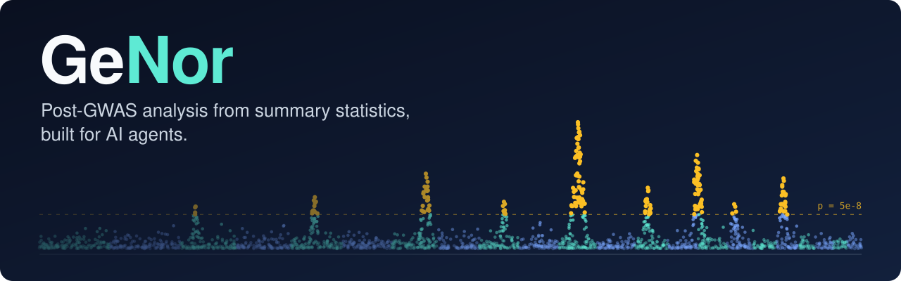

---
hide:
  - navigation
title: GeNor
---

# GeNor { .genor-title }

<p class="genor-banner" markdown>

</p>

GeNor lets Claude (and Codex, opencode, or you at a terminal) take GWAS summary statistics from
QC to genetic correlation, Mendelian randomisation, pleiotropy, fine-mapping, colocalisation and
gene-level follow-up, with a reproducible record of every step. It installs with nothing but
[uv](https://docs.astral.sh/uv/).

!!! warning "Research use only"
    GeNor is research software for academic use. It is not a medical device and must not be used
    for clinical decisions, diagnosis, or commercial services.

## Quick install

=== "Claude Code"

    ```text
    /plugin marketplace add amanzadi/GeNor
    /plugin install genor@genor
    ```

    This installs the GeNor skills, the MCP server and slash commands, and puts `genor` on
    Claude's PATH. Then ask, in a folder with your files:

    > Estimate the genetic correlation and causal effect of BMI on depression from
    > `bmi.tsv.gz` and `mdd.tsv.gz`.

=== "Command line"

    ```bash
    curl -LsSf https://astral.sh/uv/install.sh | sh                  # uv, if you don't have it
    uvx --from git+https://github.com/amanzadi/GeNor genor doctor    # until the PyPI release
    ```

    After the PyPI release this becomes `uvx genor doctor` or `uv tool install genor`.

=== "Claude Desktop, Codex, opencode"

    All use the same MCP server (`genor mcp`). Copy-paste configs for each client are on the
    [install page](install.md).

Linux and macOS (x86-64 and Apple silicon); on Windows use WSL. Python ≥ 3.11, which uv installs
for you.

## A first run

GeNor ships a simulated GWAS pair (not real data) with a planted causal effect of 0.15 and a
genetic correlation of 0.15.

```bash
genor example --out ex
genor sumstats load ex/bmi_sim.tsv.gz --trait BMI_sim --ancestry EUR --out runs/bmi
genor sumstats load ex/mdd_sim.tsv.gz --trait MDD_sim --ancestry EUR \
      --population-prevalence 0.15 --out runs/mdd
genor refdata fetch ldsc-ldscores-eur ldsc-weights-eur          # 25 MB
genor ldsc rg runs/bmi runs/mdd --out runs/rg
genor backend install plink2 && genor refdata fetch g1000-eur --yes   # 288 MB LD panel
genor mr run --exposure runs/bmi --outcome runs/mdd --overlap none --out runs/mr
genor report build runs/bmi runs/mdd runs/rg runs/mr --out report.md
```

| | Estimate (truth) |
|---|---|
| LDSC rg | 0.142, SE 0.032 (0.15) |
| MR, IVW, 141 instruments | 0.136, SE 0.018 (0.15) |
| Weighted median / weighted mode | 0.147 / 0.152 |
| Flags raised | heterogeneity, directional pleiotropy (3 pleiotropic instruments were planted) |

## Why GeNor

<div class="grid cards" markdown>

-   **Summary statistics only**

    GeNor refuses individual-level genotype data. You bring your own GWAS files; GeNor tells you
    [where to find them](data-sources.md) but never downloads GWAS or handles tokens.

-   **Agent-first**

    Every command prints one JSON object with a short summary, structured warnings, and the
    questions the agent must put to you. Bulk results go to files, not into the agent's context.

-   **Guard rails in code**

    Build and ancestry mismatches against an LD panel are errors. Palindromic SNPs, allele flips,
    MHC, inflation and sample overlap are checked and reported.

-   **Reproducible**

    Each run writes `manifest.json`: input checksums, parameters, tool and data versions,
    warnings, and the citations to use.

-   **Validated**

    Native reimplementations are tested against TwoSampleMR, coloc, R `meta` and the original
    LDSC. See [validation](validation.md).

-   **Nothing to set up**

    One tool, uv, installs everything. Reference data and PLINK 2 are downloaded on request,
    checksum-pinned, and only after you agree.

</div>

## What is included

| Area | Methods |
|---|---|
| Summary statistics | load common formats (GWAS-VCF, PLINK 2, REGENIE, SAIGE, METAL, FinnGen), QC, build inference, liftover, Manhattan/QQ |
| Meta-analysis | fixed-effect IVW, DerSimonian-Laird random effects, Q, I², sample-size weighted Z |
| Heritability, rg | LDSC h2 (observed and liability scale) and genetic correlation |
| Loci | LD clumping against 1000 Genomes with PLINK 2 |
| Mendelian randomisation | IVW, MR-Egger, weighted median, weighted/simple mode, Steiger, leave-one-out, STROBE-MR checklist |
| Pleiotropy | condFDR / conjFDR through the pleioFDR Python port |
| Fine-mapping, colocalisation | Wakefield ABF credible sets, coloc ABF (H0–H4) |
| Gene analysis | MAGMA gene, gene-set, gene-property (user-installed MAGMA) |
| Lookups | Open Targets Platform, Ensembl VEP, STRING, g:Profiler |
| Reports | Markdown + HTML combining runs, warnings, decisions and references |

Defaults and the reasoning behind them are on the [methods page](methods.md); what is not in
GeNor yet is on the [roadmap](roadmap.md).

## Where to go next

- [Install for each agent](install.md)
- [CLI reference](cli.md) and [MCP tools](mcp.md)
- [Reference data and external tools](reference-data.md)
- [Source code, issues and citation](https://github.com/amanzadi/GeNor)
